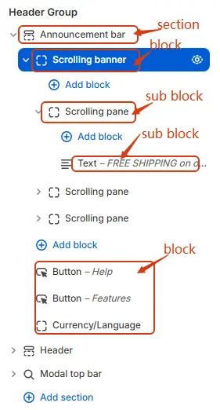
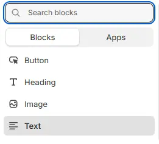
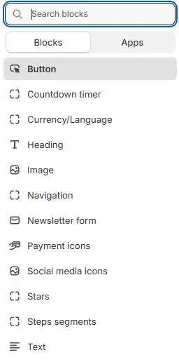

# Announcement Bar

A top notification bar that displays important messages—such as promotions, free shipping offers, or new product launches—using scrolling text.

Configure and customize your **Announcement Bar** component in the Shopify Theme Editor.

> 💡 **Tip**: Access this setting via **Shopify Admin → Online Store → Themes → Customize**.

## Structure

## Settings

- **Show announcement bar**: Toggle the visibility of the top announcement bar (e.g., for promotions, shipping notices, or alerts).  
- **Enable fixed top**: Keep the announcement bar fixed at the top of the viewport as users scroll.  
- **Background color settings** are available in the General Settings section of most blocks. For full details, refer to: [**Blocks → General Settings**](/blocks/overview#general-settings)
- **Enable background fixed**: When enabled, the announcement bar background remains stationary while the page content scrolls over it (Parallax effect). If disabled, the background scrolls normally with the page.
- **Scrolling banner width**: Controls the width of the scrolling text area as a percentage (%) of the total container width. Adjust the slider or input a value (e.g., `50%`) to determine how much horizontal space the moving text occupies.
- **Blocks alignment**: Defines the horizontal alignment of the content blocks inside the announcement bar. Options typically include: `Left`, `Center`, or `Right`.
- **Hide blocks content on mobile**: When enabled, the content blocks within the announcement bar will be hidden on mobile devices to save screen space or improve readability on smaller screens.

## Scrolling banner
The primary block is **Scrolling banner**, which supports the following settings:

- **Enable full width**: Expand the block to 100% of the viewport width, ignoring the site’s maximum content width.  
- **Block class**: Add a custom CSS class for spacing, layout overrides, or custom styling (e.g., `mt-6`, `pb-4`).  
- **Background**: Set a solid or gradient background color.  
- **Or, use image**: Apply a background image using a preset from **[Theme Settings > Style scheme settings > Background Image Schema](/theme-settings/style-scheme-settings#%EF%B8%8F-2-background-image-schema)**.  
- **Enable background fixed**: When enabled, the announcement bar background remains stationary while the page content scrolls over it (Parallax effect). If disabled, the background scrolls normally with the page.
> All four settings above follow: **[Blocks → Overview → General Settings](/blocks/overview#general-settings)**

- **Direction**: Scrolling direction, with 4 options:  
  - `To left` – scrolls from right to left  
  - `To right` – scrolls from left to right  
  - `To up` – scrolls from bottom to top  
  - `To down` – scrolls from top to bottom  
- **Height**: Overall height of the scrolling area. When direction is vertical (`To up` or `To down`), set this to `0` to enable automatic height based on content.  
- **Interval**: Time interval (in milliseconds) between scroll animations—controls scrolling speed.
- **Horizontal alignment**: Determines the horizontal positioning of the content within the scrolling area. Options usually include `Left`, `Center`, `Right`, or `no set` (default).
- **Vertical alignment**: Determines the vertical positioning of the content within the scrolling area. Options usually include `Top`, `Middle`, `Bottom`, or `no set` (default).
- **Enable automatically background**: When enabled, this feature synchronizes the background style (color, gradient, or image) of a specific target element with the scrolling pane, ensuring visual consistency.
- **Target**: Specifies the CSS selector (Class or ID, e.g., `.section-announcementbar`) of the external container that should share the background with the scrolling pane. If left blank, it defaults to synchronizing with the current node's own container.

## Scrolling banner child blocks: 

### Scrolling pane

- **Block class**: Assigns a custom CSS class to the scrolling pane container for targeted styling. Supports responsive utility classes like `mt-1`, `px-5`, `m-md`, etc., following Tailwind-like syntax (e.g., `m` = margin, `p` = padding, `t/b/l/r` = top/bottom/left/right, `x/y` = horizontal/vertical). Desktop-specific variants use `-md-*` suffixes.
- **Background**: Sets the background style of the scrolling pane. Choose from preset options or select `Custom CSS` to define gradient colors or advanced styles via inline CSS.
- **Color**: Forces all child elements inside the scrolling pane to inherit this specified color (hex code supported, e.g., `#FFFFFF`). Useful for overriding default text or icon colors within the scroll area.
- **Horizontal**: Controls the horizontal alignment of content inside the scrolling pane. Options include `left`, `center`, `right`, or `no set`.
- **Vertical**: Controls the vertical alignment of content inside the scrolling pane. Options include `top`, `middle`, `bottom`, `center`, or `no set`.

#### Scrolling pane child blocks
The Scrolling pane supports the specific blocks illustrated in the image below. Please refer to the visual guide for the complete list of compatible block types available for this section.

  
  > For detailed configuration options regarding sub-blocks, please consult the official documentation at **[Blocks](/blocks/overview#blocks-category)**.

## Announcement bar child blocks
The Announcement bar supports the specific blocks illustrated in the image below. Please refer to the visual guide for the complete list of compatible block types available for this section.

  
   > For detailed configuration options regarding sub-blocks, please consult the official documentation at **[Blocks](/blocks/overview#blocks-category)**.