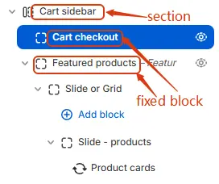

The **Cart Sidebar** section displays a slide-in cart panel on all pages **except the dedicated cart page**. To enable it, go to **Shopify Admin → Themes → Customize → Theme Settings → Cart** and set **Cart type = Sidebar**.

## Section structure

  

## Settings

### Background & Text

- **Background**: Solid or gradient background color for the sidebar.  
- **Text color**: Global text color, selected from **[Theme Settings → Basic Settings → Colors](/theme-settings/basic-settings#-4-colors)**.

### Cart header

- **Heading**: Sets the visible title text for the cart header section (e.g., “Your cart”). This is user-editable and appears as the main label above cart contents.
- **Heading tag**: Defines the HTML semantic tag used for the heading element (e.g., `h2`, `h3`, `h4`). Affects SEO structure and default browser styling; should reflect content hierarchy.
- **Heading size**: Controls the visual font size of the heading via theme-defined CSS variables (e.g., `.h3`). Does not change the HTML tag — only overrides its rendered size for design consistency. **[Theme Settings → Basic Settings → Typography](/theme-settings/basic-settings#-5-typography)**
- **Heading color schema**: Applies a global color variable (e.g., `Secondary`) to the heading text. Actual color values are managed in the theme’s color settings panel for centralized branding control. **[Theme Settings → Basic Settings → Colors](/theme-settings/basic-settings#-4-colors)**
- **Show cart items number**: Toggles visibility of the item count badge next to the heading. Only displays when cart contains ≥1 item. Useful for quick user feedback on cart status.
- **Items number color**: Sets the background or text color of the item count badge (e.g., `light Red`). Allows visual emphasis or brand alignment with notification elements. **[Theme Settings → Basic Settings → Colors](/theme-settings/basic-settings#-4-colors)**
- **Items number size**: Adjusts the scale of the item count badge using a percentage slider (default: 80%). Larger values increase badge prominence; smaller values reduce visual weight relative to heading.

### Cart Body

- Displays cart items and optional **free shipping progress bar** (configured in **Theme Settings → Cart → Free shipping bar**). 
- **Show backorder text**: Toggles visibility of a message indicating that out-of-stock items can still be ordered (backordered). Only appears for products with inventory tracking enabled and set to allow backorders. Helps manage customer expectations during stockouts.
- **Show inventory notice**: Controls when an inventory status notice (e.g., “In Stock”, “Low Stock”) is displayed. Options:  
  - `Always` — shows regardless of stock level  
  - `When inventory low` — only when below threshold  
  - `Never` — hides all inventory notices
- **Show count in inventory notice**: Determines whether the actual remaining quantity (e.g., “5 left”) is shown alongside the inventory notice. Options mirror “Show inventory notice” — useful for transparency or urgency messaging.
- **Low inventory threshold**: Sets the numeric value (default: `10`) at which the system considers stock “low”. Triggers conditional UI elements like warnings, color changes, or hidden buttons if configured elsewhere.
- **Inventory level style**: Applies a predefined visual schema (e.g., `Level schema 1`) to how inventory levels are presented — may include icons, colors, progress bars, or text styles. Managed globally in theme settings for consistency. **[Theme Settings → Style scheme settings → Inventory Level Style Schema](/theme-settings/style-scheme-settings#-9-inventory-level-style-schema)**
- **Quantity form style**: Defines the appearance of the product quantity input field in the cart (e.g., dropdown, stepper, plain number box). Schema options (like `Form style schema 1`) control layout and interaction patterns — configure via theme settings.
- **Quantity button style**: Chooses between two visual treatments for +/- quantity adjustment buttons:  
  - `Button` — solid background, prominent click target  
  - `Ghost` — transparent background without border, subtle appearance  
  Allows UI customization based on design language or accessibility needs. **[Theme Settings → Basic Settings → Colors](/theme-settings/basic-settings#-4-colors)**
- **Quantity button color schema**: Applies a global color variable (e.g., `Primary`) to the quantity buttons’ background or text. Actual hues are defined in the theme’s color settings panel for brand alignment and easy updates.

### Cart footer

- **Background**: Sets the background styling for the cart footer (which typically contains subtotal and checkout button).  
  - Supports solid colors and gradient backgrounds when configured through theme settings or custom code.  
  - If left unmodified, inherits default footer background from global theme styles.

### Announcement Alert

- **Show announcement alert**:
  - `Above cart items`  Display the inventory count at all times, regardless of stock level.
  - `Below cart items`  Show the alert immediately after the list of cart items, but before the subtotal and checkout area.  
  - `Above subtotal`  Place the alert just above the subtotal line (and any associated shipping or tax summaries). 
  - `Below checkout button`  Position the alert at the very bottom of the cart sidebar, underneath the primary checkout button.
  - `Hide` Do not display notifications
- **Text**: Alert message content.  
- **Icon**: Optional prefix icon.  
- **Icon size**: Icon scale as percentage.  
- **Color schema**: From **[Theme Settings → Basic Settings → Colors](/theme-settings/basic-settings#-4-colors)**.  
- **Radius**: Defines the corner rounding of the announcement container.
- **Text size**: Font size from **[Theme Settings → Basic Settings → Typography](/theme-settings/basic-settings#-5-typography)**.

### Empty Cart

- **Show icon**: Selects the visual symbol displayed when the cart is empty.  
  - Current selection: `Cart` — a generic shopping cart icon to reinforce context.  
  - Other options may include “Empty box”, “Sad face”, or custom SVGs depending on theme.
- **Icon size**: Controls the display dimensions of the empty cart icon in pixels (default: `100 px`). Adjustable via slider for visual balance with heading and text content.
- **Heading**: The main title shown when cart is empty (e.g., *“Your cart is empty!”*). Fully editable to match brand voice — can be playful, direct, or instructional.
- **Heading tag**: Defines the HTML semantic element used for the heading (e.g., `h3`, `h4`). Affects accessibility and SEO structure; should reflect document hierarchy.
- **Heading size**: Sets the rendered font size using theme-defined CSS variables (e.g., `.h3`). Does not change the HTML tag — only overrides its visual scale for design consistency.
- **Heading color schema**: Applies a global color variable (e.g., `Secondary`) to the heading text. Actual hues are managed in theme’s color settings panel for centralized branding control.
- **Heading alignment**: Chooses horizontal alignment of the heading:  
  - Left | Center | Right  
  - Default often centered for empty states to draw focus and create visual calm.
- **Text**: Optional descriptive or call-to-action message below the heading (e.g., “Start shopping to fill your cart!”). Supports rich formatting: bold, italic, links, lists — useful for guiding user behavior.
- **Text size**: Sets font size of the body text using theme variables (e.g., `.fs-4`). Ensures typographic harmony with other UI elements and responsive scaling.
- **Text color schema**: Applies a global color variable (e.g., `Secondary`) to the body text. Maintains visual consistency across the site while allowing easy updates via theme settings.
- **Text alignment**: Controls horizontal alignment of the body text:  
  - Left | Center | Right  
  - Often matched to heading alignment for cohesive layout.

> 💡 *This section defines the entire “empty state” experience — critical for reducing bounce rates and encouraging conversion. Customizable icons, messaging, and styling help turn a dead-end into an opportunity.*

### Recommended Products

- Displays product recommendations configured in the **[Featured Products](/blocks/function-block/featured-products)** block.  
- **Position**:  
  - `Cart item below`: Below items (when cart not empty)  
  - `Empty cart below`: Below empty state content  
  - `Both`: Show in both contexts  
  - `Hide`: Disable entirely

---

## Child Blocks

### Cart checkout
> Full checkout controls (subtotal, notes, buttons). Settings follow **[Blocks → Specific Block → Cart Checkout](/blocks/specific-block/cart-checkout)**.

### Featured products
> - Configuration follows **[Blocks → Function Block → Featured Products](/blocks/function-block/featured-products)**.  
> - Can be hidden if not needed.